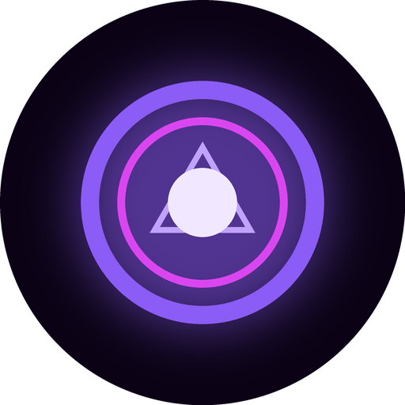
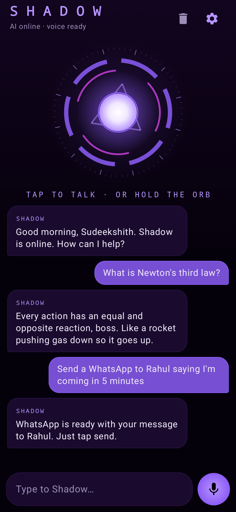
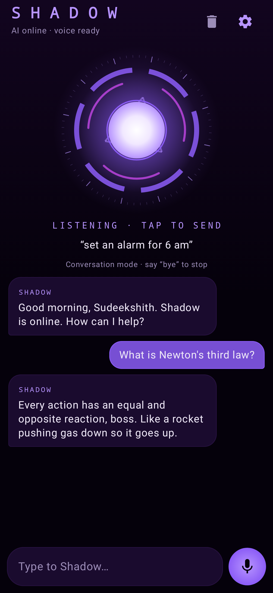
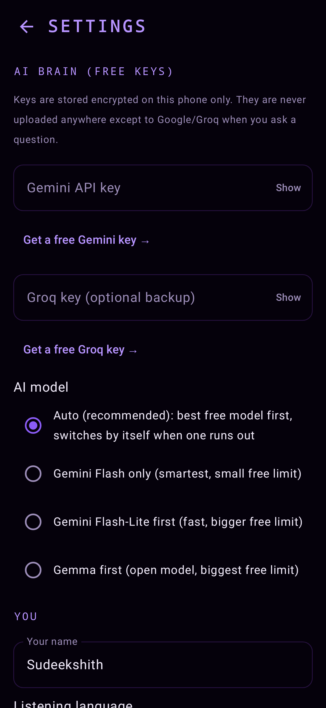

<p align="center"></p>

<h1 align="center">Shadow: your own voice AI assistant for Android</h1>

<p align="center">Talk to it, and it talks back in its own voice. It answers anything with a <b>free</b> Gemini key and does things on your phone: open apps, alarms, reminders, calls, WhatsApp, YouTube, search and the flashlight.<br>
Made by <b>Sudeekshith</b>.</p>

<p align="center">



</p>

## Features

| | What it does |
|---|---|
| 🎙️ **Two-way voice conversation** | Tap the orb and talk. Shadow answers out loud, then listens again on its own, so you can keep going back and forth. Say "bye" or tap the orb to stop. |
| 🧠 **Answers anything** | Uses Google Gemini (free tier), with Groq (free) as an optional backup. It remembers the last few turns, so follow-up questions work. |
| 🗣️ **Its own voice** | By default it picks the deepest male English voice on your phone, at a lower pitch. You can choose the voice, pitch and speed. Optionally it can use a more human Gemini voice or ElevenLabs voice. |
| 🌐 **English, ಕನ್ನಡ, हिन्दी** | Shadow replies in the language you speak. Choose your listening language in Settings. |
| 📱 **Phone actions** | Open any app, set alarms, timers and reminders, call contacts, send WhatsApp messages, search Google, play on YouTube, turn the flashlight on or off, and tell the battery level, time and date. |
| 🤖 **Natural phrasing** | The AI can trigger actions through function calling, so "ping amma on whatsapp that I'll be late" works even when it doesn't match a fixed command. |
| ✈️ **Offline commands** | Common commands are understood on the phone itself, with no internet and no AI. |
| 🔐 **Private keys** | Your API keys are stored encrypted on your phone (Android Keystore). No key is in this code. |
| ⚡ **Quick launch** | Use the "Hey Shadow" home-screen widget, the Quick Settings tile, or long-press the app icon and pick "Talk to Shadow". |
| 🟣 **Glowing orb UI** | A dark purple reactor orb that spins while thinking and pulses with your voice and Shadow's. Chat history is kept on the phone. |

### Things you can say

- "Open Instagram" · "launch camera"
- "Set an alarm for 6:30 am" · "wake me up at 5 in the morning"
- "Set a timer for 10 minutes" · "remind me in 20 minutes to drink water" · "remind me at 9 pm to study"
- "Call Amma" · "call 9876543210"
- "WhatsApp Rahul saying I'm coming in 5 minutes"
- "Play Kantara songs on YouTube" · "search for BCA syllabus Kuvempu"
- "Turn on the flashlight" · "battery level" · "what time is it"
- Anything else: "explain Newton's third law", "write a birthday message for my friend", "ನಾಳೆ ಏನು ಓದಬೇಕು?"
- "Bye Shadow" ends the conversation.

## 1. Get your free Gemini API key (2 minutes)

1. On your phone or laptop, open **https://aistudio.google.com/apikey**.
2. Sign in with your Google account and accept the terms.
3. Tap **Create API key**. If it asks for a project, pick or create one; it's free.
4. Copy the key. It starts with `AIza...`.
5. Keep it private: anyone with the key can use your free quota.

**Free limits:** these are per model, and Google changes them. In October 2026 they were about 500 requests a day for the "lite" models and about 20 a day for the bigger "flash" models. Shadow uses `gemini-flash-lite-latest` by default, and when one model hits its limit it moves on to the next. If every Gemini model is over its limit, it uses Groq, if you added a Groq key.

**Optional backup:** get a free Groq key at https://console.groq.com/keys (sign in, then **Create API Key**).

## 2. Install the app (APK)

1. Download **`Shadow.apk`** from the [latest release](../../releases/latest), or use the file you were sent.
2. Tap the file. If Android asks, allow **Install unknown apps** for your browser, WhatsApp or file manager.
3. Tap **Install**. If Play Protect warns about an unknown developer, tap **More details**, then **Install anyway**. That warning appears because the app isn't from the Play Store.
4. Open **Shadow** and allow the **microphone**.
5. Tap ⚙️, paste your Gemini key, then tap **Save**.
6. Tap the orb and say "hello Shadow". 🎉

Contacts and phone permissions are asked only the first time you say "call..." or "WhatsApp...".

**Tip:** for the best voice, install **Speech Services by Google** from the Play Store. Then in Shadow's settings, pick a voice such as `en-in-x-ene-network` (an Indian male voice).

## 3. Build it yourself

You need JDK 17 and the Android SDK (Android Studio includes both).

```bash
git clone https://github.com/acharyasudeekshith18-boop/shadow-assistant.git
cd shadow-assistant
./gradlew assembleDebug          # APK at app/build/outputs/apk/debug/app-debug.apk
./gradlew testDebugUnitTest      # unit tests + regenerates the screenshots in docs/screenshots
```

Or open the folder in **Android Studio** and press ▶ Run.

**Signed release build:** create a keystore, then add a `keystore.properties` file in the project root with `storeFile`, `storePassword`, `keyAlias` and `keyPassword`. Never commit that file; it's already in `.gitignore`. Then run `./gradlew assembleRelease`.

The GitHub Actions workflow (`.github/workflows/build.yml`) runs the tests, builds a signed APK on every push, and publishes it as a GitHub Release. Signing uses the `KEYSTORE_B64` and `KEYSTORE_PASSWORD` repo secrets; without them it publishes the debug APK.

## How it works

```
 voice ──► Android SpeechRecognizer ──► text
                                         │
                       ┌─────────────────┴─────────────────┐
                       ▼                                   ▼
              IntentRouter (offline)               Gemini / Groq (free API)
              "open insta", "alarm 6am"            answers + function calls
                       │                                   │
                       └────────────► ActionExecutor ◄─────┘
                                      (Android intents: alarm, call,
                                       WhatsApp, YouTube, torch...)
                                         │
                       spoken reply ◄── ShadowVoice (TTS / Gemini / ElevenLabs)
                                         │
                       conversation mode: listen again
```

| File | Role |
|---|---|
| `core/IntentRouter.kt` | Offline command parser (regex), unit-tested |
| `ai/GeminiClient.kt`, `ai/GroqClient.kt`, `ai/Tools.kt` | Free-tier AI calls, function calling, and the persona prompt in `ai/Llm.kt` |
| `system/ActionExecutor.kt` | Performs actions with standard Android intents |
| `ai/AiRouter.kt` | Model fallback chain: retries, daily-limit detection, Groq and Gemma backup |
| `system/Voice.kt`, `system/Listener.kt`, `core/SpeechAccumulator.kt` | Shadow's voice, the speech recognizer, and joining speech across pauses |
| `data/DebugLog.kt` | The last 20 problems, shown in Settings > Debug log |
| `ui/` | Jetpack Compose screens and the animated orb |
| `data/SettingsStore.kt` | Encrypted key storage and settings |

**Stack:** Kotlin, Jetpack Compose, Material 3, coroutines, EncryptedSharedPreferences. There are no third-party SDKs; the APIs are called over plain HTTPS.

## Honest limits

- **Internet:** answering general questions needs internet. Offline, Shadow only does phone commands, and speech recognition offline depends on your phone having an offline speech pack.
- **WhatsApp:** Shadow opens WhatsApp with the message already typed; you tap **Send**. Android doesn't let normal apps send WhatsApp messages silently.
- **No hands-free wake word:** there's no always-on "Hey Shadow" listening, because that drains the battery and Android restricts it. Use the widget, the tile or the app shortcut instead.
- **Reminders:** reminders use your Clock app's alarms and timers.
- **Free limits:** free Gemini, Groq and ElevenLabs keys all have daily limits. On a new free Gemini key, Flash allows about 20 questions a day and Flash-Lite about 500; Shadow switches models by itself and falls back to Gemma (same key, separate limit). Limits reset around 12:30–1:30 PM India time. The free ElevenLabs plan includes about 10,000 characters a month.
- **Voices:** Kannada and Hindi speech output needs those voices installed in your phone's text-to-speech settings.

## Changelog

### v1.1.0 (25 Oct 2026)
Fixes from the first real-phone test ("it cuts me off" and "sometimes no proper answer").

**Listening no longer cuts you off**
- Fixed the main bug: long answers are spoken sentence by sentence, and v1.0 re-opened the mic after the *first* sentence. That cut Shadow's own answer off and made it hear itself. Now the mic only opens after the last word, plus a short pause.
- Waits longer when you pause (about 3 s, adjustable in Settings: "When I pause while talking, wait…").
- Shows what you're saying live on screen.
- If you pause and carry on, Shadow keeps listening and joins the parts together.
- If the recognizer gives up mid-sentence, the words it already heard are kept instead of being thrown away.
- **Hold to talk:** press and hold the orb while you speak and let go to send. Nothing gets cut off this way.
- **Tap to send:** while listening, tap the orb to send what it heard right away.
- Pauses music while listening; the stuck speech service is restarted by itself; conversation mode no longer ends after a single silence.

**Better answers**
- Tries Gemini 2.5 Flash, then Gemini Flash, then Flash-Lite, then your Groq key (if added), then Gemma, a backup model with its own free limit on the same Gemini key.
- Retries once when Google is busy (503) or you hit the per-minute limit.
- Tells you plainly what happened: "I've hit today's free limit on Gemini Flash, so I switched to…", "No internet", "your key was rejected".
- Remembers which models are used up today and skips them (faster replies).
- Answers are longer and complete when you ask for an explanation, and still spoken-style; replies cut by the length limit end on a full sentence.
- Error messages are no longer sent back to the AI as conversation, and long history is trimmed.
- New **Settings > Debug log** shows the last 20 problems. Screenshot it to report a bug.

### v1.0.0 (25 Oct 2026)
First release.

## License

MIT, free to use and modify.
